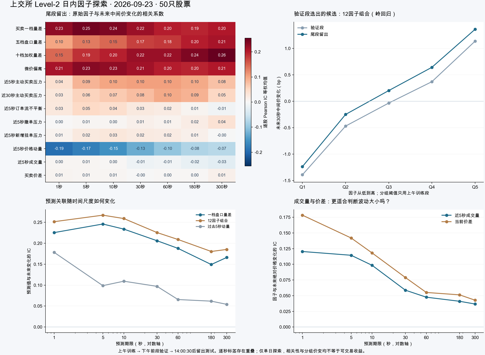
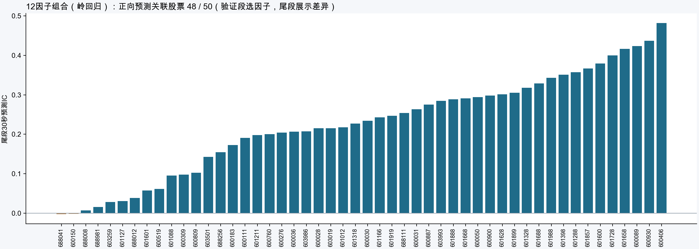

# 上交所 Level-2 日内因子研究

数据为2026-09-23的50只股票，原始文件只读。重建逐笔盘口后，以1秒网格观测，共711,100行；各期限另剔除无效报价、热身不足、过时报价和跨时段标签。

先看下方图表；[下载 report.html](https://github.com/tyoukan1994/pku_quantllm_homework/raw/refs/heads/main/lesson03/sse_l2_sim/research/report.html) 后用浏览器打开，可独立切换图表。启动模拟系统后，也可打开 [本机交互报告](http://127.0.0.1:8765/research)。GitHub 文件预览不会直接运行 HTML。模拟交易首页顶部也有入口。`report.html` 内嵌研究数据，无网络也可以切换图表；底部的本地下载链接需要服务运行。





## 本日主要发现

- 一档量差 `(买一量−卖一量)/(买一量＋卖一量)` 对秒级方向有较清晰关联：尾段未来1秒的原始IC为0.226，上午训练的单因子预测IC为0.225，价格变化样本上的方向准确率70.22%，上午多数方向基线50.50%。只有16.15%的观测在未来1秒价格改变，不能表述为所有样本70%的预测准确率。
- 预先指定30秒为主期限，在下午前段验证集比较12个单因子与固定参数的12因子岭回归，组合验证IC最高，为0.192。尾段测试IC为0.225，变化样本准确率58.63%，基线52.01%，高6.63个百分点；该期限只有46.91%的观测价格改变，48/50只股票预测IC为正。
- 30秒组合的股票平均样本外R²为−0.059，幅度预测均方误差没有优于上午均值基准。排序或方向关联不等于准确预测变化幅度。
- 组合高信号组（训练阈值Q5）未来30秒平均中间价变化+1.36bp，同组入场半价差约3.21bp；低信号组为−1.24bp。分组变化未扣费用，不能当作交易收益，更不能据此认定盈利。
- 近5秒总成交量的涨跌方向关联很弱，但它与未来1秒绝对价格变化的IC为0.120；价差与未来1秒绝对变化IC为0.178。它们更适合首先研究波动强弱，而不是单凭放量判断上涨。
- 近5秒主动买卖量差的尾段30秒原始IC约0.104，弱于盘口一档量差。近5秒动量与未来短期变化呈负相关，提示本日存在短期反向变化，但不能据一天认定稳定反转策略。

IC为各股票Pearson相关系数的等权均值。单因子预测IC允许上午训练学到正向或反向系数，因此可能不同于原始因子IC。方向准确率按变化样本合计，分组平均变化先逐股算再等权平均。

## 时间与因果顺序

每个时点只应用业务时间不晚于该时点的逐笔事件，不使用快照，也不利用未来快照来校准盘口。先重建，再计算目标。观察价是买一卖一的中间价；目标为未来h秒的中间价百分比变化，单位bp（1bp=0.01%）。

- 训练：09:30:30后到11:30，标签终点不超过11:30。
- 验证：13:00:30后到14:00，标签终点不超过14:00。
- 留出测试：14:00:30后到14:57，标签终点不超过14:57。
- 因子窗口在午休后重置，不跨午休。预测期限为1、5、10、30、60、180、300秒。
- 输入1%／99%缩尾阈值、均值与标准差只由上午训练段估计。每股、每期限独立建模，固定L2参数为1（损失按样本数归一化），无随机拆分、无参数搜索。
- 12个候选分别为一档量差、五档量差、十档加权量差、微价偏离、5秒及30秒主动买卖压力、5秒OFI、撤单压力、新增剩余挂单压力、5秒动量、5秒成交量、价差。微价偏离与一档量差有机械联系，不能当作独立证据。
- OFI由每个事件前后最优价及数量计算，再累计5秒并按过去深度归一；事件前或后无双边报价时不计算该事件OFI。
- 若当前一档报价变动或成交距观测时点超过30秒，则剔除该时点。方向未知的成交不进入主动买卖压力分母；零成交、零撤单等比率设为0。
- 五分组阈值只用上午估计；离散／零值多的因子会出现不等量甚至空组，不随机拆开相同值。

单日、高度重叠的标签和股票共同波动使样本不独立。本报告不提供基于“71万独立观测”的显著性或置信区间。另提供h秒间隔非重叠采样IC作诊断，长周期每股观测很少。除预先固定的30秒选择外，其他因子和期限比较属于探索性结果，下一步应锁定规则后做更多交易日验证。

研究不等于策略回测。市场实际成交价、手续费、延迟、冲击与A股T+1需要另行处理；本报告没有假定当天买入股票可以当天卖出。

## 复核与交付文件

- `report.html`：可独立打开的交互研究报告；`report_template.html`为页面模板。
- `overview.png/pdf`：科学图表概览；`stock_consistency.png`：30秒选定组合的逐股差异。
- `factor_metrics.csv`：12个单因子和组合、7个期限、验证／测试的汇总指标。
- `factor_samples.parquet`（约49MB，**不纳入 Git 仓库**，运行 `analyze.py` 在本机生成；页面的此项下载需要先生成文件）：每股每秒的盘口中间价、因子及未来目标。所有网格行均保留，**不能直接把全部行当成合格训练样本**；需按上面的时间／质量／目标掩码处理。市场成交数量单位为股，价格单位元，未来目标单位bp。
- `results.json`：完整汇总、逐股参数与分组结果。`verification.json`：7项因果／时间检查及21个与原引擎逐点独立复核。
- `verification.json`还保存市场共同波动调整：扣除同秒50股等权未来变化后，一档量差的1秒原始IC从0.226到0.223，30秒从0.218到0.220。该未来市场均值仅用作事后目标诊断，绝不作为预测输入；仍是同一天的结果。
- `browser_checks.json`：图表切换、下载、手机布局、账户无变化等浏览器检查。
- `provenance.json`：原始三个Parquet的文件大小及SHA-256，供复现核对。

在模拟系统目录下运行：

```sh
export SSE_L2_DATA_DIR="/你的路径/sse50_20260923"
.venv/bin/python -m pip install -r research/requirements.txt
.venv/bin/python research/analyze.py
.venv/bin/python -m unittest discover -s research -p 'test_analysis.py' -v
.venv/bin/python research/verify_data.py
.venv/bin/python research/render_report.py
```

逐股原始重建网格缓存位于模拟系统目录的 `.cache/factor_cache/*_v1.npz`。源数据或提取逻辑改变时须删除缓存后重新计算。渲染脚本优先使用 macOS Arial Unicode 字体；其他系统可用 `SSE_L2_FONT` 指定本机中文字体文件，否则使用默认字体（中文可能显示不全）。仓库内已包含本次生成的图表、完整结果 JSON 和离线报告。

## 方法来源

- [Cont、Kukanov、Stoikov：The Price Impact of Order Book Events](https://arxiv.org/abs/1011.6402)：最优价订单流不平衡与短期价格冲击；论文的同期解释不应直接冒充未来预测能力。
- [Gould、Bonart：Queue Imbalance as a One-Tick-Ahead Price Predictor](https://arxiv.org/abs/1512.03492)：一档队列不平衡与下一次中间价变化方向。其市场和预测目标不同于本报告；这里独立检验沪市固定时长目标。
