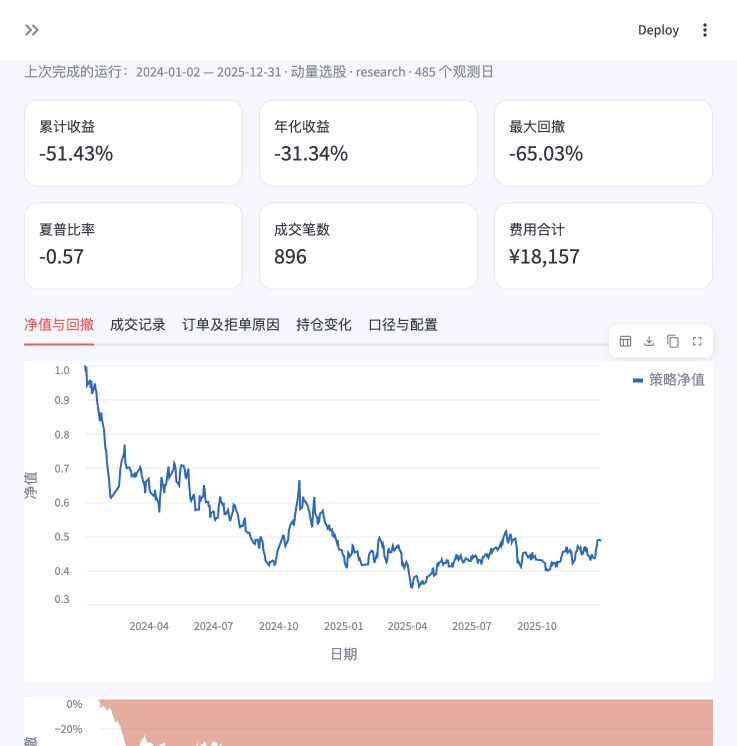

# 第四讲作业：沪深策略实验室

基于老师提供的 Feather 数据，运行沪深 A 股日频策略：收盘形成信号、下一观测日开盘尝试成交，跟踪持仓、现金、费用、订单和净值。支持在本地界面编辑 Python 策略，也可以通过命令行运行。

课程讨论：[第四讲：回测](https://github.com/aslan9/pku_quantllm/issues/8)。原始行情不重复上传，请从[老师提供的 Release](https://github.com/aslan9/pku_quantllm/releases/tag/data-backtest-20261016)下载 `feathers.zip`，解压后保留七个 Feather 文件。

[策略模板](strategies/custom_template.py) · [33 项测试](tests/test_engine.py) · [验收说明](验收说明.md) · [动量示例汇总](examples/demo_momentum/summary.json) · [均线示例汇总](examples/demo_moving_average/summary.json)

`examples/` 保存真实运行的 HTML 报告、参数摘要和策略源码快照；完整成交、订单及持仓 CSV 可使用同样参数在本机重新生成。



## 立即使用

使用 Python 3.10 及以上。克隆仓库后进入 `lesson04/ashare_backtest/`，按下面的命令建立独立环境并安装依赖。此后 macOS 可双击同目录的 **启动回测.command**，打开浏览器中的 `http://127.0.0.1:8501`。终端保持打开即可使用，结束时按 `Control+C`。

界面中选择动量、均线、等权或自定义模板，修改参数，点击“运行回测”。数据目录默认是当前用户的 `~/Downloads/feathers`，也可以通过 `ASHARE_DATA_DIR` 环境变量或界面修改。不会改写原始文件。生成的报告、CSV、源码快照和参数在本项目的 `runs/` 中，也可以直接打包下载。

首次试运行可先填入股票池 `000001.SZ,600000.SH,600519.SH,300750.SZ`，选择“固定股票篮子”。留空股票池会载入数据中全部 5,451 个沪深代码；这不等于已经核实完整历史全市场。

安装依赖与启动界面：

```sh
python3 -m venv .venv
.venv/bin/python -m pip install -r requirements.txt
.venv/bin/python -m streamlit run app.py --server.address 127.0.0.1 --browser.gatherUsageStats false
```

命令行示例（在 `lesson04/ashare_backtest/` 目录运行）：

```sh
.venv/bin/python -m ashare.cli --strategy strategies/momentum.py --start 2024-01-02 --end 2025-12-31 --output runs/my_momentum
```

自定义参数和配置：

```sh
.venv/bin/python -m ashare.cli --strategy strategies/momentum.py --params '{"lookback":60,"skip":5,"top_n":10,"rebalance_days":5}' --config config.example.json
.venv/bin/python -m ashare.cli --inspect
.venv/bin/python -m unittest discover -s tests -v
```

Windows 可将命令中的 `.venv/bin/python` 改为 `.venv/Scripts/python.exe`。也支持在激活环境后执行 `pip install -e '.[ui]'`，再运行 `ashare-backtest`。数据目录不在默认位置时使用 `--data /你的/feathers目录`。

## 编写策略

将 `strategies/custom_template.py` 复制为自己的文件，定义继承 `Strategy` 的 `UserStrategy`。每个回测日收盘后调用一次 `on_close(context)`：

```python
from ashare import Strategy

class UserStrategy(Strategy):
    def on_close(self, context):
        universe = context.universe()
        if "000001.SZ" in universe:
            return {"000001.SZ": 0.5}
        return {}
```

| 返回值或接口 | 含义 |
| --- | --- |
| `{"000001.SZ": 0.5}` | 下一观测日开盘尝试调整到 50% 权重；未列出的已有股票目标为零 |
| `{}` | 下一观测日尝试清仓，停牌或跌停等仍可能卖不出 |
| `None` | 不下新订单，保留持仓；不自动恢复等权 |
| `context.date` | 当前收盘日 |
| `context.cash`、`context.equity` | 收盘现金与总权益 |
| `context.positions` | 持仓快照；研究模式是折算股数，严格模式是实际股数 |
| `context.universe()` | 截至当前有足够有效历史、最新价格/因子/成交额有效且未被已有状态排除的代码 |
| `context.history("close", 61, symbols, adjusted=True)` | 最多 61 行、截止当前日的复权价格，返回独立副本 |
| `context.history("amt", 20, symbols)` | 截至当前日的原始成交额；金额单位按配置换算 |

权重必须非负、有限，合计不超过 1，且不超过配置中的单只股票目标上限。剩余部分为现金目标。默认不做空、不融资。用户策略可以保存计数器等状态，每次运行重新创建策略实例。

历史接口不暴露未来行，也不使用最终日期因子来归一化历史绝对价格。策略代码是本机 Python 代码，并不是安全沙箱；自行读取整份源文件仍可能引入未来信息，应通过接口取数。不要执行不信任的策略代码。

## 成交与账户流程

每天依次处理公司行为及到账 → 执行前一日目标 → 收盘估值 → 记录权益 → 调用策略生成下一日目标。

1. 回测首日为空仓，首日信号从下一日开始执行；预热历史可以使用开始日以前的数据。区间末日信号不执行，期末持仓按市值计入，不强制清仓。
2. 调仓时按当日开盘价格计算目标金额，先卖后买。目标包括被卖不出的原持仓；没有卖出的资产不会被当作现金再次使用。费用也占用预算，不允许负现金。
3. 当日买入的股份要等下一观测日才可卖出；交易日由文件日期轴提供，不使用自然日代替交易日。
4. 主板、创业板买入以 100 股整数倍申报；科创板至少 200 股，超过部分按 1 股递增。清仓可卖出全部可卖的整数零股。部分卖出按板块单位保守取整；没有模拟任意拼接零股的申报方式。
5. 开盘即涨停不买、开盘即跌停不卖，即使盘中打开也不补单。成交价格为开盘价叠加单边滑点，买入向上、卖出向下按 0.01 元取整。滑点后的价格超出日线价格范围或涨跌停边界时拒单。
6. 零成交额、缺失行情或因子、停牌、明确禁止方向的状态均不成交。使用当前全天数据进行事后有效性检查属于日线保守成交模型，不代表已证明开盘时有足够流动性。
7. 成交额上限为“上一观测日成交额 × amount_multiplier × participation_rate”，同股票当日买卖合计占用此上限。不开启用下一日全天成交额来提前筛选。单次股数上限按模拟限价申报保守限制：主板 100 万、创业板 30 万、科创板 10 万；更大目标只部分执行，不自动拆多单。
8. 未成交或部分成交的剩余委托当天失效；没有自动跨日重试。策略下一次返回权重时才重新下单。研究模式按股票代码稳定排序依次买入，资金不足会影响后续股票的成交，订单表可审计。
9. 缺失持仓行情沿用最后有效估值并显示陈旧标记，不清零、不伪造成交。长时间缺失可能涉及退市；必须补充终止上市、清算价格和损失情景才能把这样的结果当作可信收益。

## 已实现的历史规则

| 项目 | 处理 |
| --- | --- |
| 普通主板涨跌幅 | 10% |
| 主板风险警示股票 | 有历史 ST 标记时，2026-07-06 前 5%，当日起 10% |
| 创业板 | 2020-08-24 前普通股票 10%、ST 5%；当日起通常 20% |
| 科创板 | 通常 20%，风险警示不改成主板的 5% |
| 除权除息参考价 | 优先显式涨跌停价；研究模式否则用 `前收盘 × 前日因子 / 当日因子` 按分取整，再算上下限 |
| 新股与特殊无涨跌幅日 | 优先逐日 `no_limit`；有真实上市日期且 IPO 在数据日期覆盖内时识别适用的新股前 5 日无涨跌幅；旧制度首日需发行价或明确涨跌停价 |
| 风险警示买入限制 | 有 ST 标记时，对单只股票当日累计买入量限制为 50 万股；不模拟个人适当性权限 |
| 印花税 | 仅卖出：2023-08-28 前 0.1%，之后 0.05% |
| 过户费 | 双向：2022-04-29 前 0.002%，之后 0.001% |
| 佣金、滑点 | 可配置假定参数，默认佣金 0.03%、每笔最低 5 元、单边滑点 5 基点 |

规则按日期计算，不能把最新规则整体套到 2020 年。历史退市整理、重新上市、特殊复牌等应提供逐日精确限制覆盖默认推算。涨跌停价格取整和特殊参考价都应以交易所实际发布的数据为准。

费用默认佣金被视为包含经手费和证管费的假定全佣，过户费另加；不同券商可能含过户费，应按实际约定调整 `commission_rate`，当前没有额外重复加经手费。最低 5 元是可修改的佣金假设。

主要规则来源（核对日期 2026-10-16）：

- [上交所 2026 年交易规则](https://www.sse.com.cn/lawandrules/sselawsrules2025/trade/universal/c/c_20260424_10816492.shtml)
- [上交所明确主板 ST 涨跌幅变更及 2026-07-06 实施时间](https://big5.sse.com.cn/site/cht/www.sse.com.cn/aboutus/mediacenter/hotandd/c/c_20260424_10816474.shtml)
- [深交所 2026 年交易规则](https://docs.static.szse.cn/www/lawrules/rule/trade/current/W020260424690713155663.pdf)
- [深交所 2020-08-24 创业板规则变更](https://www.szse.cn/aboutus/trends/conference/t20200821_580925.html)
- [上交所科创板申报数量说明](https://edu.sse.com.cn/tib/qa/c/4866268.shtml)
- [证券交易印花税减半公告](https://shanxi.chinatax.gov.cn/web/detail/sx-11400-545-1780448)
- [券商对中国结算过户费通知及收费口径的说明](https://www.yongjinbao.com.cn/help/yjb.html)

## 两种账户口径，两个独立的严格开关

### 默认：复权研究模式 `accounting="research"`

`cumadj` 是乘法累计因子。买入 quantity 股时增加 `quantity / cumadj` 单位权益份额，持仓市值按 `份额 × 原始价格 × cumadj` 计算；卖出 quantity 股时减少相应权益份额。这样可跨分红、送转连续估值，避免把除权跳空当作市场亏损，也不会重复派发现金分红。

这相当于按数据商复权口径进行再投资近似，不是真实现金分红、税款、红股到账和实际股数账本。交易指令按整数股规则取整，但持仓折算股数可有小数；不足 1 股的残余权益不伪造卖出，继续留在持仓并披露。微小因子精度波动也可能产生少量折算残余。此模式适合目前只有价格和因子的教学研究。

### 严格账户模式 `accounting="strict"`

使用实际股数、现金及应收股息核算。持仓因子变化超过 `factor_tolerance`（默认 0.0001）且缺少对应公司行为时立即停止。阈值用于避免存储精度噪声，不能替代逐项公司行为核验。

支持普通现金分红、送转或缩股，以及现金到账日和新增股份可卖日期。含税股息按配置固定税率扣除，并先进入应收款，到账后才可买股票。无法仅根据因子辨认这些行为；配股认购、复杂重整、个税持有期补缴和退市清算不做自动猜测。产生不足一股或分笔缩股零股时停止并要求实际股数明细。

### 逐日交易状态开关 `strict_rules=true`

独立于账户模式。要求每次成交判断具有 `is_st`、`suspended`、`no_limit`，有限制日还要有精确 `limit_up`、`limit_down`，否则停止。

默认 `strict_rules=false` 可直接运行老师现有数据。缺少状态的股票按普通股规则推算；界面和报告会明确说明，不能宣称已经完全过滤 ST、识别全部停牌及特殊涨跌停。不会把首次观测日期当作真实上市日期，也不会推断历史股票名称。

## 可选数据补充

把 `data_templates/` 中对应的空表头复制为以下文件，放在所选数据目录中。原始 Feather 不需转换。逐日状态不向前或向后填充，不把今天的 ST 标记套用到过去。

`market_state.csv`：`date,symbol,is_st,suspended,no_limit,limit_up,limit_down,can_buy,can_sell`。布尔值使用 true/false 或 1/0。`can_buy`、`can_sell` 可选；`no_limit=true` 的日期可不填涨跌停价格。

`instruments.csv`：`symbol,list_date,delist_date,issue_price`。上市日期必须是真实日期。退市日期只在到达该日后阻止成交，不会把未来将退市的股票从历史股票池提前剔除。即使有退市日期，仍需另外提供实际持仓处置/清算方案，不能默认按末价卖出。

`corporate_actions.csv`：`date,symbol,cash_per_share,share_multiplier,pay_date,share_available_date`。date 为除权除息日；每股派 0.246 元填 0.246，10 转 8 的 share_multiplier 填 1.8，不变填 1。pay_date 是现金实际到账日；share_available_date 是新增股份实际可卖日；均不能早于 date。同股同日行为应事先合并。因当前接口没有配股认购款等字段，不应用这张表假装处理复杂配股。

## 结果与验证

每次运行导出：

- `report.html`：独立 HTML 报告、净值图、费用后指标、模型假设、期末持仓和订单异常；无外部图表依赖。
- `equity.csv`：每日权益、现金、应收股息、仓位、净值、回撤、费用和陈旧估值数量。
- `trades.csv`：实际模拟成交，包含信号日、成交日、数量、价格和分项费用。
- `orders.csv`：全部下单尝试及拒单/部分成交原因。没有下单的目标差额不会伪造成交。
- `positions.csv`、`events.csv`：每日持仓和公司行为等事件。
- `summary.json`：指标、配置、策略参数、输入文件 SHA-256、文件时间/大小、版本信息和口径说明。
- `strategy.py`：本次实际运行的策略源码快照。

年化采用配置中的交易日数和实际收益期数（观测日数减一）；夏普使用日收益样本标准差和配置的无风险年利率。换手为买卖成交额合计除以每日期初权益的累计值，属于双边换手。零波动时夏普为空，不伪造无穷值；没有回撤时 Calmar 为空。

可指定同数据池的单只股票作为参考，界面会标明不是市场指数。未提供指数数据时不伪造沪深300基准，也不输出所谓市场超额收益。参考股票收益用复权收盘净值，不含策略交易费用，因此是比较序列，不是同时模拟的同规则账户。

内置策略仅用于验证系统流程，未经参数优化或样本外有效性确认。保留按时间划分的验证区间；修改策略后应单独评估，不能用不断选择最好结果来替代验证。日线也不支持对盘中止盈止损顺序作精确判断。

项目结构：`ashare/` 为引擎、数据、规则、策略接口、报告与 CLI；`strategies/` 为可修改策略；`tests/` 为金融边界及数据时序回归验证；`app.py` 为本地交互界面。
