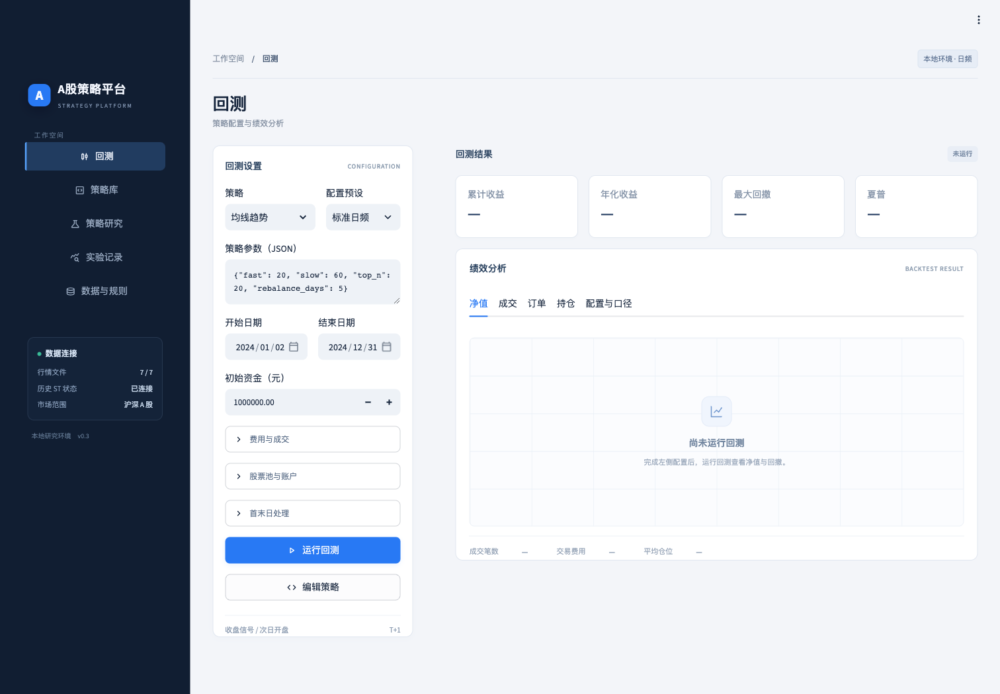
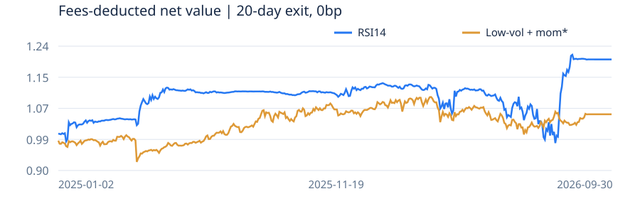
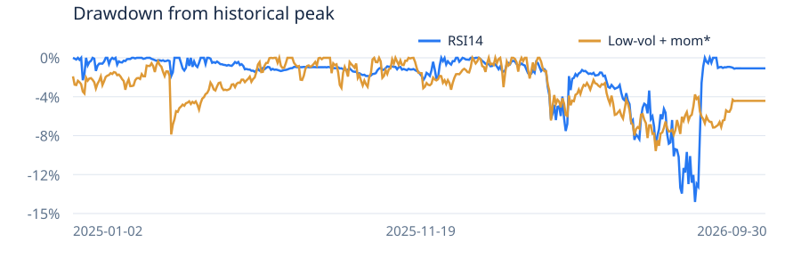

# A股日频回测平台与量价策略研究

第四讲作业报告 | 提交账号：tyoukan1994 | 2026-10-21 | 提交稿

## 摘要

本作业完成两项工作：第一，构建允许用户独立编写、保存、回测和比较策略的A股日频平台；第二，使用同一撮合与账户引擎开展量价策略探索，而不是将界面绑定在某一个策略上。

研究使用课程提供的7张Feather日频矩阵，覆盖2020-01-02至2026-10-16、1,643个观测日和5,451个沪深证券代码。2020至2024年为约定训练范围，内部再分为2020至2023年开发、2024年确认。共比较36个预先列明的技术及文献候选，完成52次开发、确认、执行压力及参照账户运行；随后固定两个开发门槛通过的候选，完成6次2025至2026年9月追加考核。

按10亿元初始资金、买卖单边万一佣金、卖出万五印花税及上日成交额1%容量约束，RSI14超卖回升策略在提前20日退出、0bp滑点口径下，2025-01-02至2026-09-30累计收益20.27%、年化收益11.60%、最大回撤14.33%，期末模拟清仓。低波动与动量组合的同期暂估累计收益为5.34%，但包含498.85万元海通证券陈旧估值，跨证券换股未建模，不能视为完全现金离场结果。

本作业证明的是平台流程可运行、结果可审计，以及若干候选在给定历史样本中的表现；不证明稳定超额收益。2024年及2025至2026年区间在此前研究中已被查看，本次不宣称全新盲测，也不根据追加考核重新调整策略。

### 作业要求与完成情况

| 要求 | 实现与核对 |
|---|---|
| 非ST股票全市场选股 | 扫描课程给定沪深代码池；信号日与买入日均要求明确非ST，未知状态不买。代码池不等于已证明无幸存者偏差的完整历史市场。 |
| 初始资金10亿元 | 所有正式策略候选采用1,000,000,000元，不融资、不做空。 |
| 佣金单边万一、印花税万五 | 佣金买卖各0.0001，印花税卖出0.0005；额外过户费和最低佣金设为0，属于作业假设。 |
| 2025首日建仓、2026年9月末离场 | 两个正式候选均于2025-01-02首次买入；保留末日单次清仓，并比较获用户批准的提前20日只卖不买退出。 |
| 允许用户自行验证策略 | 提供策略编辑、版本保存、参数搜索、独立运行及同口径比较，不将研究结果硬编码成平台主页。 |

课程数据及要求见[第四讲 Issue #8](https://github.com/aslan9/pku_quantllm/issues/8)。

<!-- pagebreak -->

## 1. 平台结构与使用方式

平台分为“回测、策略库、策略研究、实验记录、数据与规则”五个入口。常规回测与策略探索共用数据、撮合、账户和报告模块，研究流程不另建简化收益引擎。



图1：平台保留完整策略配置和结果分析区；未运行时明确显示空状态，不自动展示历史策略成绩。

| 层次 | 主要职责 |
|---|---|
| 数据层 | 读取OHLC、成交额及累计复权因子，按配置截止日期截断；加载时点化ST、停牌及上市/退市状态。 |
| 策略层 | 通过上下文获取截至当前日的信息，返回目标权重、空目标或不发新单。 |
| 撮合与账户层 | 次日开盘尝试交易，处理价格、可卖股数、容量、费用、现金与研究模式权益份额。 |
| 研究与归档层 | 保存候选、参数、源码快照、输入指纹、冻结清单、订单和结果；不同口径比较时提示差异。 |
| 展示层 | 净值与回撤、成交和拒单、持仓、配置口径，以及开发、确认和追加考核分开展示。 |

策略接口示意如下。这里只说明调用契约，不代表本报告的实证策略：

```python
class UserStrategy(Strategy):
    def on_close(self, context):
        return {"000001.SZ": 0.01}
```

返回权重字典表示下一观测日尝试调整，`{}`表示尝试清仓，`None`表示不发新单。用户策略是本机Python代码，不是安全沙箱，不能执行不可信代码。历史接口限制未来行，但无法阻止用户绕过接口自行读入未来数据。

<!-- pagebreak -->

## 2. 数据、复权与交易约束

### 2.1 数据频率与样本边界

七张表均以交易观测日为行、证券代码为列，属于日频宽表，不是分钟或逐笔数据。字段为`open`、`high`、`low`、`close`、`amt`、`num_trades`及`cumadj`。其中`num_trades`是成交笔数，不能直接当作成交股数、成交量或换手率。原始amt金额单位沿用平台的“元”假设，仍须以数据提供者口径最终确认。

正式策略在给定代码池中动态扫描，仅保留近120日价格完整、历史状态明确非ST的股票；过去20日平均成交额不低于1亿元，再取流动性前1,500只。最多设置100个目标，每只目标权重0.95%；不足100只时保留现金，不强行加仓。卖出受阻及不足1股的复权残余可能使实际持仓代码数多于目标数。

### 2.2 复权与账户处理

研究信号使用乘法调整价格：`P_adj[t,i] = P_raw[t,i] × cumadj[t,i]`。不以考核期末因子归一化历史绝对价格；同一信号日只读取该日及以前的数据。成交仍采用原始开盘价格。

默认研究账户买入q股时记录`q / cumadj`单位权益，估值按`权益份额 × 原始价格 × cumadj`计算。这是按数据商口径进行复权再投资的近似，不是真实现金分红、送转到账与股息税账本，更不能自动处理跨证券换股。严格账户模式在必要公司行为缺失时停止；本次成绩来自研究模式。

### 2.3 日频执行规则

| 项目 | 本平台的模拟处理 |
|---|---|
| 时序与T+1 | 收盘形成信号，下一观测日开盘尝试成交；当日买入股数下一观测日才可卖。首日信号来自2024年末，首日费用和损益计入考核。 |
| 申报数量 | 主板、创业板买入按100股整数倍；科创板至少200股、超过部分按1股递增；可卖整数零股清仓另行处理。 |
| 涨跌停 | 普通主板与科创/创业板按历史日期及板块规则推算；优先使用已有精确限价。开盘涨停不买、开盘跌停不卖，不因盘中打开而补单。 |
| 大额订单 | 按板块限价申报数量上限拆单，子单共享当日容量；这是开盘成交研究近似，不是完整市价委托模拟。 |
| 容量与现金 | 同股票当日买卖成交额合计不超过上一观测日成交额1%；先卖后买、计入费用，不允许负现金或将未卖出资产当作现金。 |
| 停牌与缺失 | 停牌、零成交额、缺失价格或因子、退市后不成交；已有持仓保留并按最近有效价格估值，显示陈旧标记。 |
| 滑点与未成交 | 基础滑点0bp，另列5bp或10bp压力；滑点后越过日线高低价或涨跌停边界拒单。普通未成交委托当天失效，不自动无限重试。 |
| 退出与残余 | 20日退出从2026-09-02起只卖不买、每日重试；不强制造成交。末日不足1股的模型残余可按原配置零值核销并计损，完整股份不得如此处理。 |

申报数量与板块交易规则参考[上交所科创板投教](https://edu.sse.com.cn/tib/qa/)及[深交所创业板规则说明](https://investor.szse.cn/institute/rules/t20200813_580574.html)。日频数据不能还原盘口、排队、盘中路径或精确开盘冲击，1%全天成交额上限不等于已证明开盘可承接该金额。

<!-- pagebreak -->

## 3. 策略设计与候选筛选

### 3.1 研究分层

约定训练范围为2020至2024年。本次在内部使用2020至2023年开发、2024年确认：两批候选分别事前列明、分别选参，冻结后才运行本批2024年确认。2020年包含指标预热，不纳入年度稳健评分。已知该区间曾在旧研究中被查看，因此仅称训练内部确认。

开发评分为：`年度夏普中位数 + 0.25 × 最差年度夏普 - max(0, abs(开发期最大回撤) - 0.25)`，年度指2021、2022、2023年。开发门槛为三年至少两年盈利、开发累计收益为正、平均仓位至少20%、最大回撤不超过40%。先满足门槛、再按评分排序，每类最多一个；首批固定5个、文献批固定3个进入确认。门槛未过的入围者仅作诊断，不自动推荐。

首批24个版本覆盖RSI14、RSI2、布林带、反转、动量、通道突破、均线、低波动、低波反转、低波动量、量价及市场宽度12类。另根据Alpha101、52周高点、隔夜与日内收益拆分、Amihud流动性等文献新增12个候选。成交量、VWAP、行业或市值不足的原策略不声称完整复现；成交额改编明确单列。完整36候选见附录与附件CSV。

### 3.2 RSI14超卖回升

令`ΔP[t] = P_adj[t] - P_adj[t-1]`，上涨量`U[t] = max(ΔP[t], 0)`，下跌量`D[t] = max(-ΔP[t], 0)`。前14个有效涨跌幅均值作为初值，随后按Wilder平滑：`G[t] = (13×G[t-1]+U[t])/14`，`L[t] = (13×L[t-1]+D[t])/14`，`RSI[t] = 100×G[t]/(G[t]+L[t])`。连续全平明确约定50，只有上涨为100、只有下跌为0；缺失后重新预热，不用简单滚动均值冒充Wilder版本。[RSI计算参考](https://www.tradingview.com/support/solutions/43000502338-relative-strength-index-rsi/)

- 买入：昨日RSI不高于30，今日高于30；信号收盘后形成，次日开盘尝试。
- 选择：已有合格持仓优先保留，空余名额按新信号股票的20日平均成交额排序补足。
- 卖出：RSI达到60，或实际持仓满10个交易日后发出下一日退出信号；不把未成交委托算作建仓。
- 仓位：每日检查，最多100个目标，每只0.95%。冻结的是无MA60过滤版本；过滤版交易机会过少。

### 3.3 低波动75%与动量25%组合

低波得分为过去20日日收益标准差负值的截面百分位排名；动量为`P_adj[t-5]/P_adj[t-65]-1`的截面百分位排名，跳过最近5日。综合分为`0.75×低波排名 + 0.25×动量排名`。按分数选择100个目标，每只0.95%，每10个交易日调仓。该策略借鉴低风险与动量思想，不是AQR期货趋势或BAB多空组合的原样复现。

<!-- pagebreak -->

## 4. 开发与2024年确认结果

36个候选只有上述两个通过开发门槛。以下8个为两批研究事前冻结的确认对象，表中开发收益是2020至2023年累计，不能当作年化或与一年收益直接按大小类比。所有收益均在相同10亿元账户与约定费用下计算。

| 策略 | 开发累计 | 2024收益 | 2024回撤 | 夏普 | 门槛 |
|---|---|---|---|---|---|
| 低波动75% + 动量 | 11.15% | 15.68% | -7.25% | 1.302 | 通过 |
| RSI14回升(无过滤) | 0.80% | 30.01% | -15.15% | 1.389 | 通过 |
| 60日低波动 | -1.86% | 30.11% | -7.36% | 1.880 | 未过 |
| 布林下轨回升(无过滤) | -12.05% | -4.00% | -21.39% | -0.083 | 未过 |
| 20日反转 | -6.45% | -1.53% | -15.47% | 0.026 | 未过 |
| 52周高点 + 低波动 | -3.76% | 17.55% | -8.40% | 1.375 | 未过 |
| 收益与成交额变化背离 | -8.35% | 15.81% | -13.02% | 0.856 | 未过 |
| 成交额异常放大(成交额改编) | -43.80% | -18.58% | -34.03% | -0.408 | 未过 |

低波动与动量组合开发期累计11.15%，2021年和2023年为正、2022年亏损，其2024年收益为15.68%。RSI14开发累计仅0.80%，但2024年达到30.01%，表现对时期敏感，不能只因单年收益较高就认定有效。60日低波动2024年收益30.11%，但开发累计为负，未据确认结果将其重新选为冠军。

新增12个文献候选均未过开发门槛。比如，本地Alpha101 #33、#101改编在开发期累计收益分别为-44.20%、-59.76%；这些是给定股票池、A股多头、5日调仓与费用容量设定下的结果，不是对原文策略在其他市场或完整多空组合中的否定。

52周高点与低波组合2024年收益17.55%，收益与成交额变化背离版本为15.81%，但开发累计分别为-3.76%、-8.35%，因此仅保留为诊断。网络上“有名”或原论文中有效，不等于本平台当前口径下有效。

### 参照账户与解释范围

开发与确认各运行一个“流动性前100只、每20日等权调仓”的同口径参照账户。其2020至2023年累计收益为-42.05%，2024年为8.37%。这不是沪深300、全市场指数或行业中性基准，不能据此宣称市场超额收益或风险调整后的纯Alpha。

探索共52次运行：36次开发、8次确认、6次滑点压力及2次参照。所有负收益、低仓位及未达标版本保留。年度收益、仓位、费用与参数可在附件和平台中核查，不只展示赢家。

<!-- pagebreak -->

## 5. 2025至2026年9月追加考核

在用户明确要求后，仅对原冻结清单中开发门槛通过的两个候选追加考核，不根据2024年或追加考核增选其他策略。实际区间为2025-01-02至2026-09-30，共424个观测日；均于首日首次买入。主结果沿用提前20日退出、0bp滑点，保留费用与1%容量约束。

| 策略 | 累计收益 | 年化收益 | 最大回撤 | 夏普 | 平均仓位 | 清仓 |
|---|---|---|---|---|---|---|
| RSI14回升 | 20.27% | 11.60% | -14.33% | 0.820 | 35.86% | 是 |
| 低波动量(暂估) | 5.34% | 3.14% | -9.26% | 0.339 | 80.14% | 否 |

| 策略 | 2025收益 | 2026年1至9月 | 首笔买入 |
|---|---|---|---|
| RSI14回升 | 12.67% | 6.75% | 2025-01-02 |
| 低波动量(暂估) | 6.71% | -1.28% | 2025-01-02 |





图2至图3：同一账户口径下的真实日度净值和回撤，不是因子收益乘目标权重。低波组合含海通证券陈旧估值，曲线需结合下一节解读；未提供外部指数数据，不绘制伪造基准。

RSI14主结果年化11.60%、夏普0.820、平均仓位35.86%，费用约1,181.98万元，期末模拟清仓；累计收益20.27%并不意味着始终满仓。低波组合年化暂估3.14%、夏普0.339、平均仓位80.14%，但未完成现金离场。按本考核区间观察，RSI强于低波组合；这不改变其训练期证据偏弱的事实，也不保证未来表现。

<!-- pagebreak -->

## 6. 退出机制、滑点与未清仓资产

### 6.1 执行对照

两个候选分别固定末日单次清仓、提前20日退出，以及提前20日退出加单边5bp滑点，共6次运行。原始对照完整保留，不能根据收益高低事后选择退出方案或将部分成交伪装成清仓。

| 策略/退出/滑点 | 累计收益 | 最大回撤 | 夏普 | 清仓 | 剩余市值(万元) |
|---|---|---|---|---|---|
| 低波动量/末日/0bp | 2.69% | -9.26% | 0.198 | 否 | 33,057.03 |
| 低波动量/20日/0bp | 5.34% | -9.26% | 0.339 | 否 | 498.85 |
| 低波动量/20日/5bp | 6.08% | -8.75% | 0.382 | 是 | 0.00 |
| RSI14/末日/0bp | 18.92% | -14.33% | 0.772 | 否 | 18,718.91 |
| RSI14/20日/0bp | 20.27% | -14.33% | 0.820 | 是 | 0.00 |
| RSI14/20日/5bp | 22.56% | -13.26% | 0.899 | 是 | 0.00 |

末日单次退出的RSI和低波组合分别仍有约1.87亿元、3.31亿元股票市值。10亿元账户即使信号正确，也不代表最后一天能按1%容量全部卖出。提前退出显著降低残余，但不能消除停牌、退市和公司行为覆盖问题。

5bp滑点组收益不一定更低：价格取整、日线高低价拒单和容量会改变实际成交、后续持仓与费用，并不是从原净值简单扣一条固定成本。对照只能说明执行路径敏感，不能证明滑点提高收益，更未据此调参或将较高数字改成主成绩。

### 6.2 海通证券换股未建模

低波动0bp组期末仍记录600837.SH的479,200股折算权益，按旧价格保留4,988,472元市值，出现391个陈旧估值观测日。上交所公告确认海通证券因吸收合并自2025-03-04起终止上市，公司公告说明A股按1:0.62换股。[上交所公告](https://www.sse.com.cn/disclosure/announcement/listing/stock/c/c_20250226_10773005.shtml)、[公司换股公告](https://www.hkexnews.hk/listedco/listconews/sehk/2025/0225/2025022501027_c.pdf)

当前引擎未实现跨证券代码换股与到账，因此5.34%只能标为暂估权益收益，不能当作严格现金离场成绩。将这笔资产期末估值设为零，仅作估值压力时累计收益约4.84%；这不是实际换股价值为零，也不是已发生全损。未因发现该问题删除海通代码、回头改变选股或重跑一个“更好”的主结果。

后续应补齐登记日、换股比例、到账及可交易日期、零股处理和新证券映射，再以新版本引擎单独复核，并保留现有结果作为模型对照。RSI主组期末无股票和陈旧估值，但仍采用复权研究近似。

<!-- pagebreak -->

## 7. 验证、局限与复现

### 7.1 已完成的验证

- 85项单元测试通过，覆盖账户与规则、平台策略和运行管理、研究冻结、RSI平滑及缺失重启、在线与缓存计算一致性、因果前缀和文献因子公式。
- 前52次探索逐笔审计覆盖1,657,415笔成交；追加6次考核另行核对。非ST状态、信号严格早于成交、1%容量、佣金、印花税和现金约束均未发现违反。
- 追加考核退出期买入数为0；两个主结果同口径比较无差异提示。股数、无法成交及陈旧估值仍保留原记录，不因通过审计就认定数据和公司行为完全正确。
- 实际浏览器与Streamlit测试验证了策略编辑、运行、比较、研究记录、考核报告下载及未清仓警告。平台是可编辑工具，不是截图原型。

### 7.2 结论边界

第一，给定5,451代码池未证明覆盖完整历史市场，可能存在幸存者与数据选择偏差。第二，2024及考核区间此前已经被查看，两批候选又进行了多重尝试，因此不能宣称独立盲测或统计显著，未作多重检验校正。第三，精确逐日涨跌停价、盘口冲击、公司行为现金流与跨代码换股不足，真实执行能力仍未被证明。第四，没有行业、市值及指数数据，不能声称行业中性、指数增强或风险调整后的纯Alpha。第五，固定费用来自作业假设，不等于所有历史时点的实际税费。

本作业较有力的结论是：同一平台能够规范地区分策略信号、实际成交、账户权益与可兑现现金；候选间有可审计的历史差异。较弱的结论是：某个参数组合在未来仍有稳定收益。下一步应优先完善公司行为和执行模型，再进行真正新增时期的预先登记检验，而不是继续以已查看区间挑选更好看的参数。

### 7.3 本地复现与提交边界

```sh
python3 -m venv .venv
.venv/bin/python -m pip install -r requirements.txt
.venv/bin/python -m unittest discover -s tests -v
.venv/bin/python -m streamlit run app.py
```

将课程行情放入本机数据目录，在“数据与规则”连接；严格非ST研究还需本机授权的历史ST/停牌与上市资料。源码、策略、测试和汇总数据可以提交，课程原始Feather、授权状态文件、账户凭据、完整本机工作目录和大体积逐股明细不随报告上传。不具备相同历史状态数据时，不应声称已复现本报告的非ST硬约束成绩。

提交附件包括：本报告Markdown与PDF、36候选汇总、8次确认汇总、6次考核与年度结果、58次运行审计摘要、两条主考核净值曲线、界面截图和输入/源码指纹摘要。报告内数值由已归档结果读取，不为写报告重新调参或重跑考核。

<!-- pagebreak -->

## 参考资料

本报告将下列资料作为思路或公式来源，不将其发表收益直接移植成本地成绩。长短仓结构、持有期或输入字段有改编时，均以本平台实际参数为准。

1. [课程第四讲要求与数据说明](https://github.com/aslan9/pku_quantllm/issues/8)，以及[课程Release](https://github.com/aslan9/pku_quantllm/releases/tag/data-backtest-20261016)。
2. [TradingView：Relative Strength Index](https://www.tradingview.com/support/solutions/43000502338-relative-strength-index-rsi/)。用于核对RSI与Wilder平滑口径。
3. [Connors Research：ConnorsRSI介绍](https://tradingmarkets.com/connorsrsi-download-the-code-now)。借鉴短周期RSI研究方向；本次RSI2不等于三分量ConnorsRSI。
4. [John Bollinger：Bollinger Band Rules](https://www.bollingerbands.com/bollinger-band-rules)。用于布林带候选与触轨解释边界。
5. [QuantConnect：Short-Term Reversal Strategy in Stocks](https://www.quantconnect.com/research/15311/short-term-reversal-strategy-in-stocks/)。用于短期反转、流动性选择和成本讨论。
6. [Moskowitz、Ooi与Pedersen：Time Series Momentum](https://www.aqr.com/Insights/Research/Journal-Article/Time-Series-Momentum)，及[Frazzini与Pedersen：Betting Against Beta](https://www.aqr.com/insights/research/journal-article/betting-against-beta)。本地低波动量不是两篇论文的原样复现。
7. [Kakushadze：101 Formulaic Alphas](https://arxiv.org/abs/1601.00991)。本地选取可用价格字段计算的#33、#101及标明的改编。
8. [George与Hwang：The 52-Week High and Momentum Investing](https://onlinelibrary.wiley.com/doi/10.1111/j.1540-6261.2004.00695.x)。本地以252日最高复权收盘价构造改编信号。
9. [Lou、Polk与Skouras：A Tug of War](https://personal.lse.ac.uk/polk/research/TugOfWar.pdf)。用于历史隔夜与日内收益拆分思路。
10. [NYU V-Lab：Amihud Historical Illiquidity](https://vlab.stern.nyu.edu/docs/liquidity/ILLIQ-HIST)。用于绝对收益与成交额比值。
11. [Gervais等：The High-Volume Return Premium](https://onlinelibrary.wiley.com/doi/10.1111/0022-1082.00349)，以及[Lee与Swaminathan：Price Momentum and Trading Volume](https://doi.org/10.1111/0022-1082.00280)。缺少成交量/换手率，本地只单列成交额改编，不声称复现原策略。
12. [RiceQuant内置因子文档](https://www.ricequant.com/doc/rqfactor/api/biult-in-factor)。用于核对因子接口与所需字段。
13. [上交所科创板投教](https://edu.sse.com.cn/tib/qa/)与[深交所创业板申报规则说明](https://investor.szse.cn/institute/rules/t20200813_580574.html)。本平台只模拟与日频研究相关的部分规则。
14. [上交所海通证券终止上市公告](https://www.sse.com.cn/disclosure/announcement/listing/stock/c/c_20250226_10773005.shtml)与[公司换股公告](https://www.hkexnews.hk/listedco/listconews/sehk/2025/0225/2025022501027_c.pdf)。用于核实陈旧估值背后的公司行为。

<!-- pagebreak -->

## 附录A：24个技术候选完整开发结果

区间2020-01-02至2023-12-29；收益为累计、回撤为相对历史峰值，均含约定费用。排序保留原协议顺序，不删除失败版本。门槛标准见第3节。

| 候选 | 累计收益 | 最大回撤 | 夏普 | 平均仓位 | 门槛 |
|---|---|---|---|---|---|
| RSI14回升(无过滤) | 0.80% | -27.63% | 0.085 | 47.70% | 通过 |
| RSI14回升(MA60) | 0.08% | -0.02% | 0.598 | 0.01% | 未过 |
| RSI2回撤 / 阈值5 | 9.32% | -16.15% | 0.245 | 41.63% | 未过 |
| RSI2回撤 / 阈值10 | -6.43% | -24.28% | -0.025 | 58.55% | 未过 |
| 布林下轨回升(无过滤) | -12.05% | -34.87% | -0.109 | 68.50% | 未过 |
| 布林下轨回升(MA60) | -0.87% | -6.84% | -0.055 | 9.56% | 未过 |
| 5日反转 | -32.01% | -37.68% | -0.644 | 49.20% | 未过 |
| 20日反转 | -6.45% | -26.41% | -0.040 | 53.53% | 未过 |
| 60日动量(跳过近期) | -53.03% | -57.55% | -0.626 | 79.64% | 未过 |
| 120日动量(跳过近期) | -43.37% | -54.78% | -0.486 | 75.73% | 未过 |
| 20日通道突破 | -74.23% | -77.11% | -1.321 | 85.40% | 未过 |
| 60日通道突破 | -69.18% | -73.05% | -1.075 | 85.32% | 未过 |
| MA20 / MA60 | -55.37% | -60.82% | -0.634 | 81.01% | 未过 |
| MA60 / MA120 | -51.87% | -56.85% | -0.555 | 83.66% | 未过 |
| 20日低波动 | -4.89% | -18.65% | -0.071 | 70.62% | 未过 |
| 60日低波动 | -1.86% | -20.02% | 0.017 | 79.32% | 未过 |
| 低波动50% + 反转 | -12.89% | -20.90% | -0.368 | 41.33% | 未过 |
| 低波动75% + 反转 | -10.37% | -19.14% | -0.255 | 57.08% | 未过 |
| 低波动50% + 动量 | 8.21% | -19.16% | 0.253 | 52.26% | 未过 |
| 低波动75% + 动量 | 11.15% | -17.44% | 0.352 | 60.40% | 通过 |
| 成交额放大反转 | -30.74% | -37.06% | -0.590 | 52.58% | 未过 |
| 收盘位置量价反转 | -24.99% | -31.13% | -0.552 | 50.20% | 未过 |
| 市场宽度减仓 / 低波动50% | -9.70% | -17.35% | -0.316 | 36.82% | 未过 |
| 市场宽度减仓 / 低波动75% | -7.49% | -14.65% | -0.227 | 47.73% | 未过 |

<!-- pagebreak -->

## 附录B：12个文献候选完整开发结果

条件与附录A一致。下表均未通过开发门槛，不以其2024年结果事后改写开发结论。Alpha101只保留可用字段计算的版本；成交额不冒充成交量。

| 候选 | 累计收益 | 最大回撤 | 夏普 | 平均仓位 | 门槛 |
|---|---|---|---|---|---|
| 接近52周高点 | -36.40% | -53.93% | -0.552 | 65.26% | 未过 |
| 52周高点 + 低波动 | -3.76% | -20.45% | -0.061 | 54.36% | 未过 |
| 五日日内收益反转 | -26.82% | -32.61% | -0.547 | 46.08% | 未过 |
| 五日隔夜收益反转 | -72.93% | -75.53% | -1.401 | 74.58% | 未过 |
| Amihud低非流动性 | -24.78% | -38.99% | -0.321 | 83.43% | 未过 |
| Amihud高非流动性 | -52.61% | -57.69% | -0.750 | 80.26% | 未过 |
| Alpha101 #33 / 日内反转 | -44.20% | -49.27% | -0.678 | 70.12% | 未过 |
| Alpha101 #101 / K线实体 | -59.76% | -62.27% | -1.291 | 69.00% | 未过 |
| K线实体反转 / 改编对照 | -23.28% | -29.50% | -0.486 | 49.29% | 未过 |
| ATR归一化五日反转 | -28.68% | -34.32% | -0.755 | 45.62% | 未过 |
| 成交额异常放大(成交额改编) | -43.80% | -47.67% | -0.551 | 86.70% | 未过 |
| 收益与成交额变化背离 | -8.35% | -22.45% | -0.092 | 61.05% | 未过 |

### 汇总附件索引

- [全部候选](tables/all_candidates.csv)：36候选的累计收益、年化、回撤、夏普、仓位、费用及年度表现。
- [确认比较](tables/confirmation.csv)：8个冻结确认对象，不按2024收益重选。
- [考核比较](tables/evaluation.csv)：6组执行口径及分年度收益。
- [58次运行审计摘要](tables/audit_summary.csv)：订单约束核对与对应运行编号，不含逐股授权行情。
- [主考核日度净值](tables/evaluation_curves.csv)：净值和回撤曲线所用数据。
- [指纹与复现摘要](provenance.json)：输入文件名、哈希、冻结标识及不随报告公开的资料边界。
